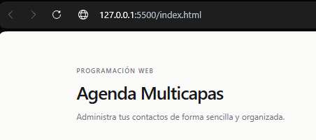
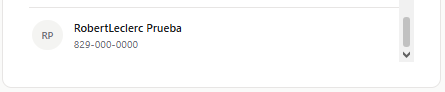

# Tarea 3 - Agenda Multicapas

**Asignatura:** Programación Web  
**Estudiante:** Robert Leclerc  
**Institución:** ITLA  
**Profesor:** Raydelto Hernández

## Descripción
Desarrollo de una agenda web utilizando HTML, CSS y JavaScript, que permite visualizar y agregar contactos mediante Fetch API y los métodos HTTP GET y POST.

## Tecnologías utilizadas
- HTML5
- CSS3
- JavaScript
- Fetch API
- JSON

## Captura de pantalla

## Prueba de registro de contacto

Se realizó una prueba agregando un nuevo contacto a la agenda mediante el método HTTP POST.

